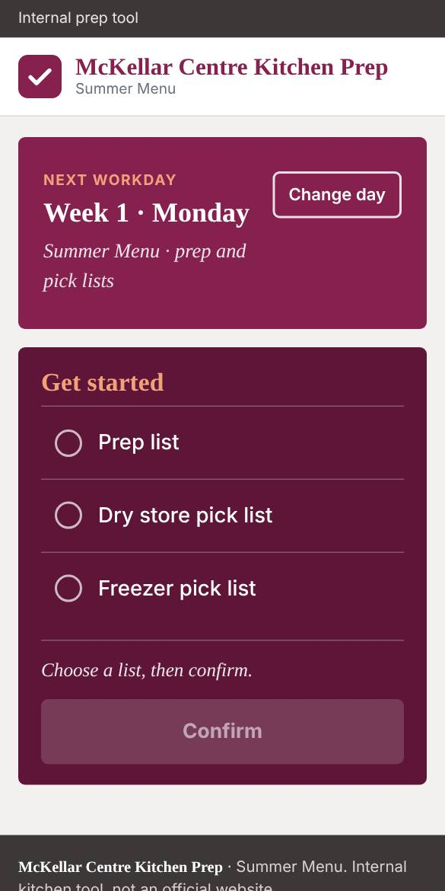
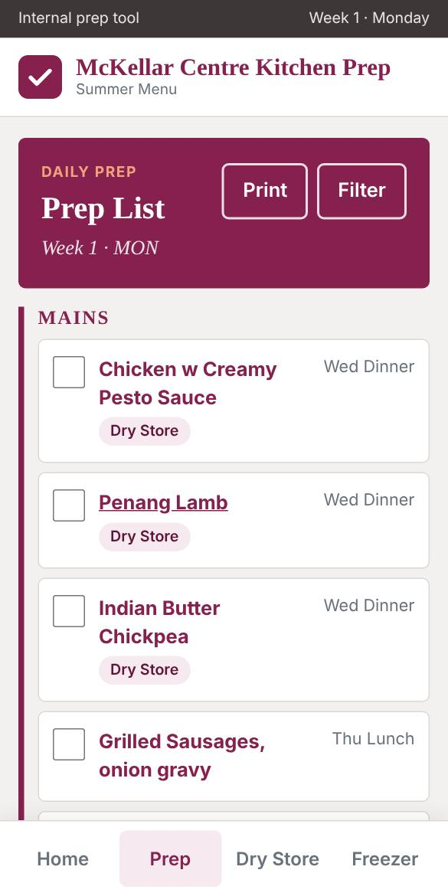
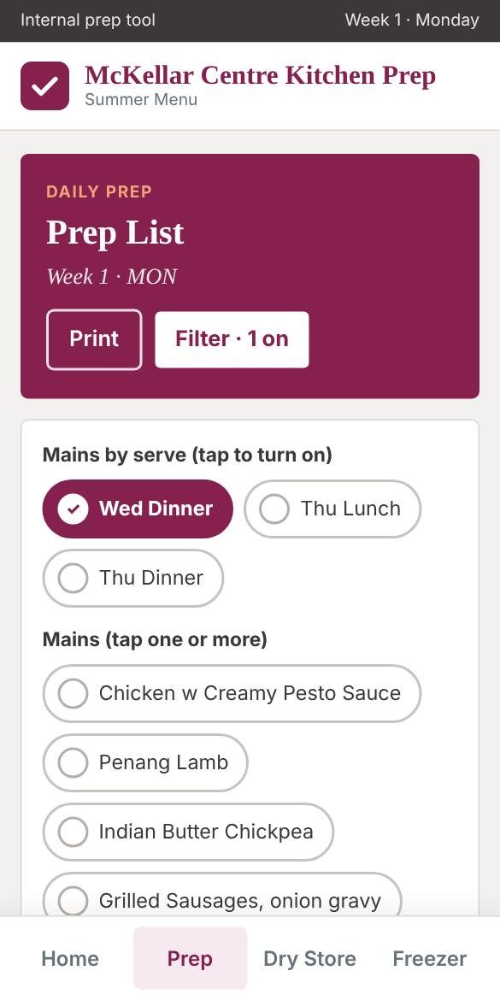
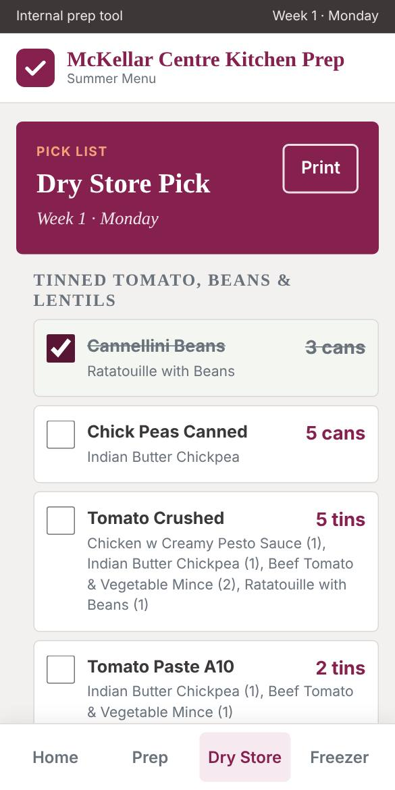

# McKellar Centre Kitchen Prep

Prep lists, recipes and pick lists for the **Summer Menu (Week 1 and Week 2, Monday to Friday)**, built for the kitchen team at McKellar Centre (Barwon Health).
A small static website: plain HTML, CSS and JavaScript, with all content in three JSON files, so anything can be fixed by editing a file on github.com.

**Live site:** https://h-fikri.github.io/bh-prep/
**Status:** version 1 (October 2026). Not an official Barwon Health website.

| Home | Prep list | Filter mains | Dry store pick |
|---|---|---|---|
|  |  |  |  |

*(Screenshots are taken in a sandbox without internet, so the heading font falls back to a default serif. On a real phone the headings use Zilla Slab. More images are in [`docs/img`](docs/img).)*

---

## Contents

1. [What it does](#what-it-does)
2. [How to use it (for cooks)](#how-to-use-it-for-cooks)
3. [How to change things (for editors)](#how-to-change-things-for-editors)
4. [Repository map](#repository-map)
5. [How it works](#how-it-works)
6. [Data](#data)
7. [Running and testing locally](#running-and-testing-locally)
8. [Publishing and updating](#publishing-and-updating)
9. [Design and code conventions](#design-and-code-conventions)
10. [Known limitations](#known-limitations)
11. [More documentation](#more-documentation)
12. [Licence](#licence)

---

## What it does

- **Prep list** for any day: Mains, Veg, Soups and Prep sections, with serve time, quantity, notes and location badges (Freezer, Dry Store). Each main links to its **recipe page**.
- **Recipe pages** (108 dishes: mains and soups): title, ingredients, amounts and notes only. No times, temperatures, production amounts, dates or method (this is a deliberate project rule).
- **Dry Store pick list** and **Freezer pick list** for any day: what to pick, how much, and which dish it is for.
- **Tick boxes** on every prep and pick item. Ticks are saved on the device (no login, no server).
- **Filter mains** by serve time (for example "Wed Dinner" or "Thu Lunch") or by individual dishes. Location filter applies to every section.
- **Print** button: plain A4 portrait layout.
- **Works offline** after the first visit (service worker).
- **Picks the right day for you:** the home page suggests today, or the next workday on weekends, and works out whether it is Week 1 or Week 2.
- **Home flow:** one card says which day it is, one card lets you pick a list, then you press **Confirm** before the page opens.

## How to use it (for cooks)

1. Open the site. The top card shows the day it thinks you want (for example *Week 1 · Monday*). On Saturday and Sunday it shows the next Monday and says **Next workday**.
2. Wrong day? Tap **Change day**, choose Week 1 or Week 2 and the day, then tap **Done**. **Back to today** resets it.
3. In **Get started**, tap one of: Prep list, Dry store pick list, Freezer pick list. A tick appears and the line under the list repeats your choice.
4. Tap **Confirm and open**. (The button is greyed out until you choose a list. Nothing opens before you confirm.)
5. On a list page:
   - Tap the box to tick an item off. A ticked item gets a pale background and a line through its name.
   - On the **prep list**, tap a main dish name to open its recipe. Use **Back to list** to return.
   - Tap **Filter** to show only some mains. Selected options turn solid berry with a tick, and a bar above the list says what is on and lets you remove each one or **Clear all**.
   - Tap **Print** for a paper copy.
   - Use the bottom bar on a phone (or the top menu on a computer) to jump between Home, Prep, Dry Store and Freezer for the same day.
6. **Clear ticks** (pick pages) wipes the ticks for that list on this device.

Ticks are stored in the browser on that device only. They do not sync between phones. See [Known limitations](#known-limitations) for the tick-reset caveat.

## How to change things (for editors)

Everything is a plain text file. On github.com, open the file, press the pencil icon, edit, and commit. The live site updates within about a minute. After a change, hard-refresh the page (Ctrl + Shift + R on a computer, or reload twice on a phone).

| I want to... | Edit this | Where |
|---|---|---|
| Change the site name or the "Summer Menu" subtitle | [`assets/app.js`](assets/app.js) | `SITE_NAME` and `SITE_SUB` at the very top. One place only: it updates the header, footer and browser tab on every page. |
| Fix an ingredient, amount or recipe note | [`data/dishes.json`](data/dishes.json) | Find the dish by `dishName`, edit `amountText` or `notes`. |
| Fix a prep quantity, note, serve time or location | [`data/prep.json`](data/prep.json) | Find the row by `week`, `day`, `item`. |
| Fix a dry store or freezer pick line | [`data/pick.json`](data/pick.json) | Find the row by `week`, `day`, `list`, `item`. |
| Add or remove a whole dish | `data/dishes.json` **and** `data/prep.json` | Add the dish block, then add a prep row whose `dishSlug` matches. |
| Change which week is Week 1 or Week 2 | [`assets/app.js`](assets/app.js) | `anchorDate`. See [Week 1 / Week 2](#week-1--week-2). |
| Change colours, fonts or sizes | [`assets/styles.css`](assets/styles.css) | Colour variables at the top in `:root`. |
| Change the home page wording | [`index.html`](index.html) | The two cards. |

Field-by-field rules, examples and a pre-commit checklist for the data files are in [`data/README.md`](data/README.md). **Read it before editing JSON**: one missing comma stops a page loading.

## Repository map

```
bh-prep/
├── index.html            Home: "Next workday" card + "Get started" card + Confirm
├── prep.html             Prep list for one day (filter, tick boxes, print)
├── pick.html             Dry Store / Freezer pick list for one day (?list=dry|freezer)
├── dish.html             One recipe (?dish=<slug>)
├── sw.js                 Service worker: offline support (network first)
├── assets/
│   ├── app.js            Shared code: site name, week logic, header/footer/nav, tick storage, helpers
│   └── styles.css        All styling: tokens, components, responsive rules, print rules
├── data/
│   ├── prep.json         294 prep rows (Week 1+2, Mon-Fri; MAINS, VEG, SOUPS, PREP)
│   ├── dishes.json       108 recipes (mains and soups), nested (one block = one dish)
│   ├── pick.json         175 pick rows (125 dry store, 50 freezer)
│   └── README.md         Data guide: fields, examples, editing rules
├── tools/
│   ├── build_data.py     Excel -> prep.json + dishes.json (one-off conversion)
│   ├── pick_data.py      Excel -> pick.json (one-off conversion)
│   ├── smoke_test.py     Health check: data integrity + every page at 320/375/1200 px
│   └── README.md         How to use the tools, and when NOT to
├── docs/
│   ├── HANDOFF.md        Full project brief, history, decisions, backlog, starter prompt for a new session
│   ├── DESIGN.md         Design system: colours, type, components, breakpoints, print, accessibility
│   └── img/              Screenshots used in the docs
├── LICENSE               MIT
└── README.md             This file
```

There is **no build step, no framework and no package manager**. What is in the repository is exactly what is served.

## How it works

### Page flow

```
index.html ──(Confirm)──▶ prep.html?week=1&day=mon
                      └─▶ pick.html?week=1&day=mon&list=dry | freezer
prep.html ──(tap a main)──▶ dish.html?dish=beef-lasagne ──(Back)──▶ history.back()
```

All pages load `assets/app.js` first. It exposes helpers on `window.PrepUtils`, and each page has a small inline script that fetches JSON, filters it for the chosen week and day, and builds the DOM.

### URL parameters

| Page | Parameters | Notes |
|---|---|---|
| `prep.html` | `week` = 1 or 2, `day` = `mon` `tue` `wed` `thu` `fri` | Missing either: "Missing week or day." |
| `pick.html` | `week`, `day`, `list` = `dry` or `freezer` | Anything other than `freezer` is treated as `dry`. |
| `dish.html` | `dish` = dish slug | Unknown slug: "Dish not found." |

### Shared page chrome

`renderChrome(active, week, day)` in `assets/app.js` builds, on every page: a dark utility bar ("Internal prep tool" and the current week/day), the white header with the brand mark and name, the top menu (desktop), the footer, and the bottom bar on phones (Home, Prep, Dry Store, Freezer, only when a week and day are known). It also sets the browser tab title: the site name on the home page, otherwise "Page name · site name".

### Week 1 / Week 2

The menu alternates weekly. The site works out which week a date falls in from one anchor date:

- `anchorDate = Monday 1 December 2025` is **Week 2**. Every second Monday after it is Week 2, the others are Week 1.
- Saturday and Sunday are treated as the **next Monday**.
- Confirmed against the kitchen roster calendar: **Monday 12 October 2026 = Week 1**, then 19 October = Week 2, 26 October = Week 1, and so on.
- If the rotation ever shifts (a gap week, a new menu), change `anchorDate` in `assets/app.js` to any Monday that is known to be Week 2.

### Where state is stored

Only in the browser's `localStorage`. Every read and write is wrapped in try/catch because some browsers block it.

| Key | Holds |
|---|---|
| `prep:{week}:{day}` | Ticked prep items, e.g. `prep:1:mon` |
| `pick:{week}:{day}:{list}` | Ticked pick items, e.g. `pick:1:mon:dry` |

### Offline support

`sw.js` is a **network-first** service worker: it always tries the network (so edits on GitHub appear straight away) and falls back to the cached copy when there is no signal. All pages, scripts, styles and JSON files are pre-cached on first visit. The cache name is `bh-prep-v4`; bump it if the list of core files in `sw.js` changes. Google Fonts are not cached (the page falls back to a system serif for headings offline).

### Filters on the prep page

- **Mains by serve** and **Mains (individual dishes)** only affect the MAINS section. Veg, Soups and Prep are never hidden by them.
- **Location** (Freezer, Dry Store) affects every section.
- Selected state is kept in one object (`sel`), the chips and the "Filtering: showing X of Y mains" bar are both drawn from it, so they cannot disagree.

## Data

Three JSON files in [`data/`](data/). Short version:

| File | One row is... | Key fields |
|---|---|---|
| `prep.json` | one line on a day's prep list | `week`, `day`, `section`, `item`, `dishSlug`, `location`, `usageNote`, `qty`, `notes` |
| `dishes.json` | one recipe | `dishSlug`, `dishName`, `ingredients[]` (`ingredient`, `amountText`, optional `group`, `notes`), optional `notes[]` |
| `pick.json` | one line on a pick list | `week`, `day`, `list`, `group`, `item`, `pick`, `forDish`, `note`, `skip` |

The data was converted from the kitchen's Excel files (which were themselves made from photos of the printed prep sheets and recipe books). **The JSON is now the source of truth.** Full detail: [`data/README.md`](data/README.md).

## Running and testing locally

You need Python 3 only (any static file server works; the site must be served over http, opening the files directly will not load the JSON).

```bash
git clone https://github.com/h-fikri/bh-prep.git
cd bh-prep
python3 -m http.server 8000
# open http://localhost:8000/
```

Health check (data integrity and every page at phone and desktop widths):

```bash
pip install playwright && playwright install chromium     # once
python3 tools/smoke_test.py
```

Expected: `All checks passed`. Details of what it checks are in [`tools/README.md`](tools/README.md).

## Publishing and updating

- The site is served by **GitHub Pages** from the `main` branch. Merging a pull request or committing straight to `main` updates the live site in about a minute.
- Safe routine for bigger changes: make a branch, open a pull request, check, merge. For a one-word typo fix, editing on `main` is fine.
- If a page shows "Failed to load ... data" after an edit, a JSON file has a syntax error (usually a missing comma or quote). Open the commit history for that file and revert the last commit.
- After deploying, users with the page open or cached may see the old version until they refresh. The service worker checks the network on every load, so a normal reload is normally enough.

## Design and code conventions

- **Own identity.** The look is inspired by a corporate website (berry colour, slab headings, flat cards) but uses its own tick-mark logo and name. It does not use Barwon Health logos or branding, and the footer says it is an internal tool, not an official website.
- **No build step, no dependencies** apart from the Google Fonts stylesheet (Zilla Slab, with Rockwell/Georgia fallback).
- **Data is rendered with `textContent`**, never as HTML, so a stray `<` or `&` in a recipe cannot break a page.
- **Colour is never the only signal.** Selected filters have a tick; ticked items have a strike-through; the active menu item is tinted (phone) or underlined (desktop) in berry.
- **Big tap targets** and 17px base text for use with gloves, wet hands and at arm's length.
- **`[hidden]` is global** (`display: none !important`) so the `hidden` attribute always wins.
- Full detail: [`docs/DESIGN.md`](docs/DESIGN.md).

## Known limitations

The complete, prioritised list is in [`docs/HANDOFF.md`](docs/HANDOFF.md). The ones that matter most:

1. **Ticks never reset by themselves.** The storage key has no date, so because Week 1 Monday comes round every fortnight, last fortnight's ticks will still be there. The prep page has no "clear ticks" button yet.
2. **Veg items** show names only (no quantity or location) because the Veg List file is not filled in yet, and veg is not on the pick lists.
3. **Eight recipe notes** are still transcription remarks such as "please verify" or "cut off in the photo", copied from the Excel files. Find them in `data/dishes.json` and fix or delete them.
4. **Odd freezer quantities:** Basa fish fillet is counted in "serve" and one figure is `199.62 serve` (Thai Ginger Fish, Week 2 Friday).
5. **The repository is public.** Anyone with the link can read the recipes and prep lists. If that is not wanted, make the repository private (GitHub Pages on a private repository needs a paid plan).

## More documentation

| File | For |
|---|---|
| [`data/README.md`](data/README.md) | Anyone editing the JSON: field meanings, real examples, rules, checklist |
| [`tools/README.md`](tools/README.md) | The Excel conversion scripts and the smoke test |
| [`docs/DESIGN.md`](docs/DESIGN.md) | Anyone changing how it looks |
| [`docs/HANDOFF.md`](docs/HANDOFF.md) | A new person or a new Claude session picking the project up: history, decisions, backlog, evaluation checklist, starter prompt |

## Licence

MIT, see [`LICENSE`](LICENSE). The recipes and menu content belong to their owners and are used here for internal kitchen prep.
